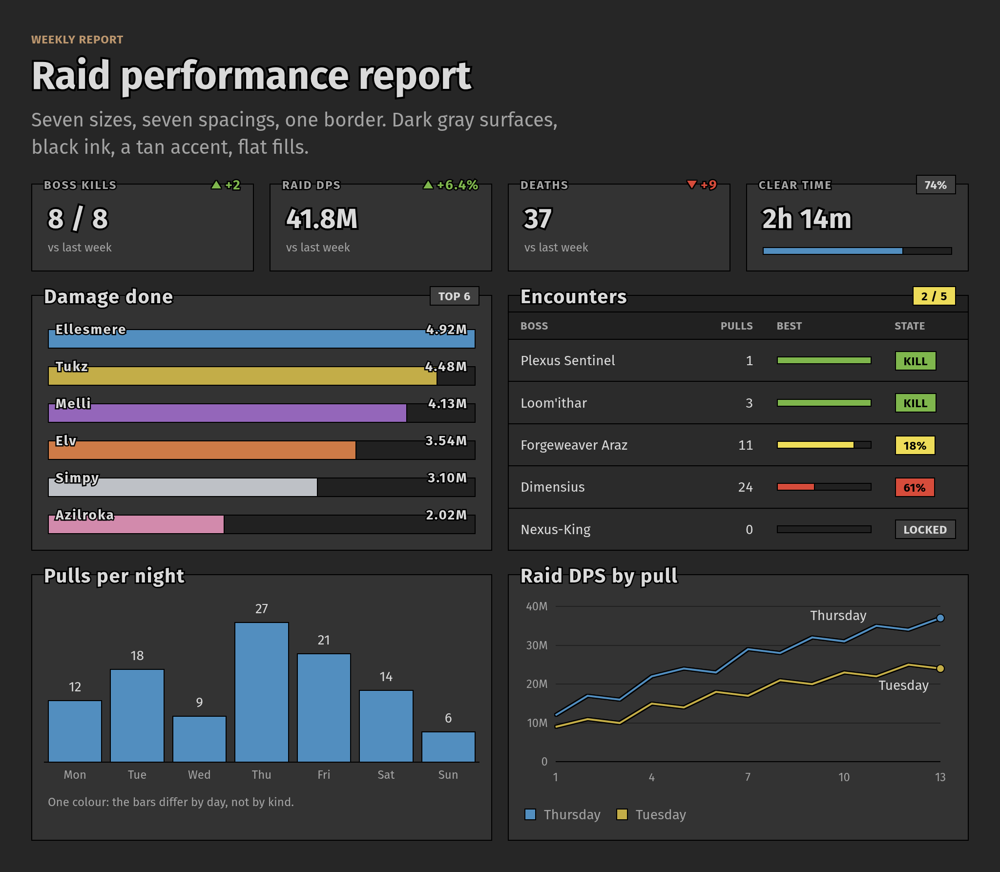
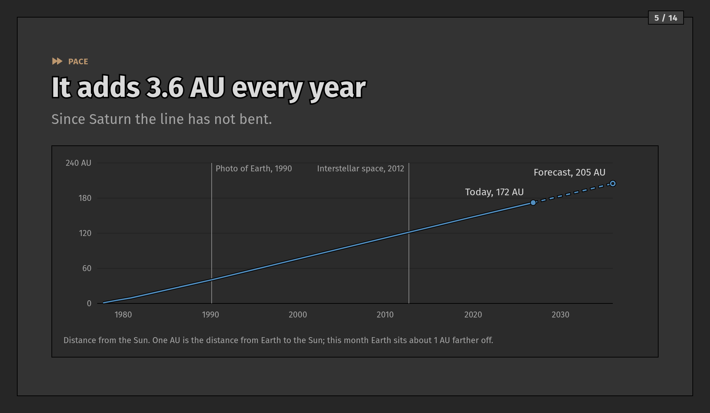
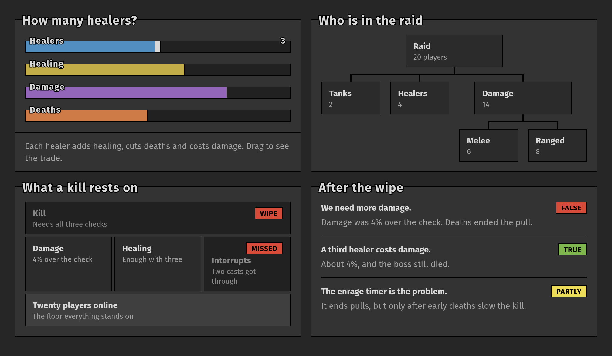

# style



My visual style, packaged as a plugin for Claude Code and Codex. It is listed in the [`joshua-light` marketplace](https://github.com/joshua-light/marketplace). It steers reports, explainers, animated explainers, dashboards, slides, and charts toward one look: dark gray panels, black borders, square corners, a Warrior-tan accent, flat colour fills, and Expressway text with outlined headings. It steers the telling too: every page is a story built one step at a time from the simplest case, with one chart form repeated, each term defined where it arrives, and one colour per recurring thing.

<p>
  
  
</p>

The screenshots come from the pages in `examples/`, set in Fira Sans, the face an install shows. Open `examples/showcase.html` in a browser to see every component. Open `examples/story-report.html` to see a report told as a story, one step at a time. Open `examples/voyager-deck.html` to see a deck: step through it with the arrow keys or a click. Open `examples/gc-film.html` to see an animated explainer: press Play on a film, then Next for each beat.

## Credits

The style builds on work by others:

- [ElvUI](https://tukui.org/elvui) by the Tukui team. Its pixel-thin black borders, dark backdrops, and outlined text set the look.
- [EllesmereUI](https://www.curseforge.com/wow/addons/ellesmereui) by Ellesmere. Its overall polish is the starting point.
- [Expressway](https://typodermicfonts.com/) by Ray Larabie, Typodermic Fonts. The typeface both interfaces use.
- [Fira Sans](https://github.com/mozilla/Fira) by Carrois Apostrophe, for Mozilla and Telefónica. The bundled fallback.
- [3Blue1Brown](https://www.3blue1brown.com/) by Grant Sanderson. Films take from it the idea of explaining with motion: a picture that changes while a sentence says why.
- [Remix Icon](https://remixicon.com) by Remix Design. Its fill set supplies the symbol icons.
- [Michael Silveira](https://michaelsilveira.me/), for the [didactician](https://github.com/gravitypersists/didactician) skill and the [ETH explainer](https://gravitypersists.github.io/explainer-eth-disproved/) made with it. The explainer components here follow that page: steppers, quizzes, margin notes, linked prose. `examples/eth-explainer.html` restyles its text and figures.

## Fonts

Out of the box, pages are set in Fira Sans. Its Regular and Bold ship in `skills/guide/assets/fonts/` under the SIL Open Font License, cut down to Latin, Greek, Cyrillic, and symbols.

The style was drawn for Expressway and uses it where you add it. Expressway is licensed by Typodermic and its files carry a "do not distribute" notice, so this repo does not include them. Put your own copies here:

| File | Style |
| --- | --- |
| `skills/guide/assets/fonts/expressway.{woff2,ttf,otf}` | Expressway Bold, the file ElvUI ships as `Expressway.ttf`. |
| `skills/guide/assets/fonts/expressway-xb.{woff2,ttf,otf}` | Expressway Extra Bold. Sets emphasis only where Regular is not installed. |

With the Bold file in place, text is set in Expressway Regular, a free download from [DaFont](https://www.dafont.com/expressway.font) or 1001 Fonts. Its desktop licence forbids converting or embedding the file, so do not put it in this repo: install it on your machine (for example in `~/.local/share/fonts/`) and the stylesheet finds it by name. On a machine without it, text falls back to Expressway Bold.

Install the TrueType file, `expressway rg.ttf` (version 6.000), not the OpenType `expressway rg.otf` (version 6.100). The OpenType file has wrong hinting zones: on Linux its round letters (`o`, `e`, `s`) render a pixel taller than `n` and `r` at text sizes.

Without the Bold file, Fira Sans sets everything, even where Expressway Regular is installed: the two faces never mix. Fira Sans takes Expressway's ascent and descent, so layouts match in either face.

Add the files to a clone, not to an installed copy: an update replaces the installed copy. See Develop below.

Embedding Expressway in pages you publish may need a web licence from Typodermic.

## Layout

| Path | Purpose |
| --- | --- |
| `skills/guide/SKILL.md` | The rules. Both tools load it. |
| `skills/guide/assets/style.css` | Tokens and components. |
| `skills/guide/assets/style.js` | Tooltips, hover highlighting, reveal on scroll, tabs, sorting, steppers, quizzes, bound sliders, menus, toasts, dialogs, the contents rail, deck keys, builds, and popups. |
| `skills/guide/assets/film.js` | Films: figures that play one beat at a time, for animated explainers. The player, and the parts a stage is drawn with. |
| `skills/guide/assets/style.mplstyle` | The same look for matplotlib charts. |
| `skills/guide/assets/mermaid.json` | The same look for Mermaid diagrams. |
| `skills/guide/assets/icons/remix-fill.json` | Remix Icon's fill set, one icon per line. |
| `skills/guide/assets/fonts/` | Fira Sans, the fallback face, and its licence. Your Expressway files go here too; git ignores them. |
| `skills/guide/scripts/build.py` | Inlines the stylesheet, the scripts, and the fonts into a page. |
| `skills/guide/scripts/lint.py` | Checks a page's own CSS, markup, and text against the rules, and names each breach by line. Counts words too: a long heading, caption, or sentence is a warning. |
| `skills/guide/scripts/shot.py` | Screenshots a page, a part of it, or a deck's slides, every mark finished, or a film held at any moment. Needs Chrome or Chromium. |
| `skills/guide/scripts/icon.py` | Prints the markup for an icon, or looks one up by name. |
| `skills/guide/scripts/highlight.py` | Prints a code sample as highlighted markup, with numbered or lit lines, or as a diff. Needs Pygments. |
| `skills/guide/scripts/mpl_style.py` | Finishes a matplotlib figure: ink rings on lines, outlined title. |
| `skills/guide/scripts/plotly_style.py` | Registers the plotly template. |
| `examples/showcase.html` | Reference markup for every component. The guide reads it before it builds a page. |
| `examples/showcase-mermaid.png`, `examples/showcase-plotly.png` | The showcase's samples of the Mermaid and plotly themes. |
| `examples/story-report.html` | The reference story: an experiment on what AI models cost, told from the simplest approach up, each step in the same form. |
| `examples/voyager-deck.html` | The reference deck: builds, growth, a popup, motion to scale, and a speed slider for review. |
| `examples/gc-film.html` | The reference for films: the .NET garbage collector explained in seven films, with two quizzes and a recap. |
| `examples/film-reel.html` | Three short films on a canal lock, a garbage collector, and a raid boss's threat table, each built on a different kind of motion. |
| `examples/square-film.html` | Completing the square in three films: an equation whose terms follow the picture, and sliders that replay a film on your numbers. |
| `examples/eth-explainer.html` | A long explainer page: Michael Silveira's ETH explainer, restyled. Its licence sits beside it. |
| `.claude-plugin/plugin.json` | Claude Code plugin manifest. |
| `.codex-plugin/plugin.json` | Codex plugin manifest. |
| `assets/screenshots/` | The README's screenshots. |
| `assets/icon.svg` | Icon source. Re-render the PNG with `rsvg-convert -w 1024 -h 1024 assets/icon.svg -o assets/icon.png`. |

## Install

Add the marketplace once, then install the plugin from it.

Claude Code:

```sh
claude plugin marketplace add joshua-light/marketplace
claude plugin install style@joshua-light
```

Codex:

```sh
codex plugin marketplace add joshua-light/marketplace
codex plugin add style@joshua-light
```

Claude then loads the `style:guide` skill before it builds anything visual.

## Develop

An installed plugin is a cached copy: it does not follow your edits, and it has no Expressway files. To work on the style, clone this repo and load the clone.

For one Claude Code session:

```sh
claude --plugin-dir /path/to/style
```

To keep it loaded, make the clone a local marketplace. It is private to your machine and separate from the public `joshua-light` one; `style-dev` below is only its local name. Write these two files in the clone; git ignores both.

`.claude-plugin/marketplace.json`:

```json
{
  "name": "style-dev",
  "owner": { "name": "Your Name" },
  "plugins": [{ "name": "style", "source": "./" }]
}
```

`.agents/plugins/marketplace.json`, for Codex:

```json
{
  "name": "style-dev",
  "plugins": [
    {
      "name": "style",
      "source": { "source": "local", "path": "./" },
      "policy": { "installation": "AVAILABLE", "authentication": "ON_INSTALL" },
      "category": "Creativity"
    }
  ]
}
```

Then register the clone:

```sh
claude plugin marketplace add /path/to/style
claude plugin install style@style-dev

codex plugin marketplace add /path/to/style
codex plugin add style@style-dev
```

Claude Code reads the plugin straight from the clone, so edits apply at the next session start or after `/reload-plugins`. Codex runs a cached copy: refresh it with `codex plugin add style@style-dev`.

Install the plugin from one marketplace only: `style@style-dev` or `style@joshua-light`. Two copies would both answer to `style:guide`.

## License

MIT for the code and rules in this repo. Expressway, ElvUI, and EllesmereUI belong to their authors.

The Fira Sans files in `skills/guide/assets/fonts/` are published under the SIL Open Font License 1.1; the licence text sits beside them.

The text and figures of `examples/eth-explainer.html` come from [explainer-eth-disproved](https://github.com/gravitypersists/explainer-eth-disproved), copyright 2026 Michael Silveira, used under the MIT License. The notice is in the page and in `examples/eth-explainer-LICENSE.txt`.

The icons in `skills/guide/assets/icons/` are Remix Icon 4.8.0, published under Apache 2.0; the licence text sits beside them. Remix Icon releases from January 2026 use the Remix Icon License v1.0 instead, which also allows icons inside a design system but not resale as an icon pack. Read it before updating the set.
